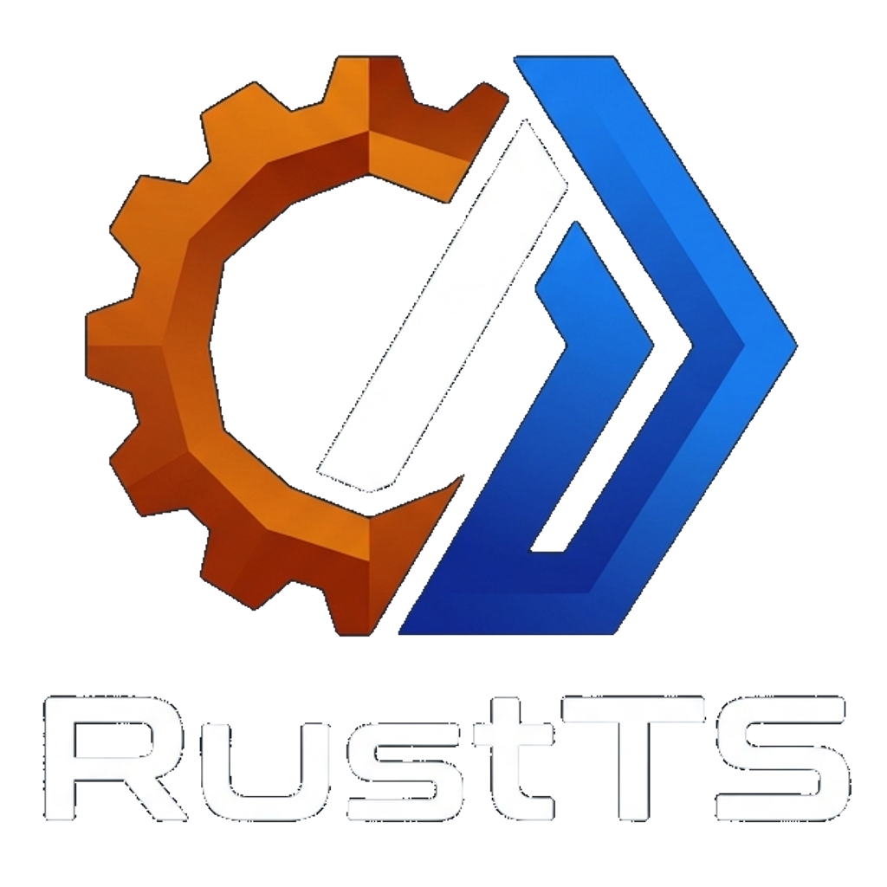

<p align="center">
  
</p>

# RustTS (`rtsc`) — Devlog de Evolução Arquitetural, Versões e Testes (`v0.1.0-rts` → `v2.2.0-rts`)

Registro técnico cronológico da criação, auditorias de especificação, otimizações SIMD/memória, evolução semântica e validação em hardware real do compilador **RustTS (`rtsc`)**.

- **Repositório Oficial:** [LuizCorrea-Dev/RustTS](https://github.com/LuizCorrea-Dev/RustTS) (`main`, `v2.2.0-rts`)
- **Autor:** Luiz Correa — Rootszera
- **Toolchain Nativa Verificada:** `rustc 1.99.1` / `cargo 1.99.1` + `LLVM/Clang 22.1.3` (`-std=c11 -O3 -mavx2 -mfma -Wall -Wextra -Werror`)

---

## Sumário Cronológico e Evolução de Versões

| Versão | Marco / Etapa | Principais Entregas Técnicas | Resultado de Benchmarks & Testes |
| :--- | :--- | :--- | :--- |
| **`v0.1.0-rts`** | Fundação do Workspace & Front-End / Sema Base | 11 módulos iniciais em Rust (`logos`, AST, parser, sema, GBNF, C99/Unreal/Unity); matriz Tier 1 vs Tier 0 (`RTS-E0900`) | Teste de mesa: `thermal_control.rts` OK; `NetworkSocket::send` bloqueado com `RTS-E0402` |
| **`v0.2.0-rts`** | Hardening de Contratos & 1º Benchmark 10k | `@sealed_sig` vs `@open_sig` (`RTS-E0402`), Call Graph transitivo (`RTS-E0403`), anti-forja (`RTS-E0404`), hierarquia de arenas (`RTS-E0501`), AoS→SoA (`pos->px[i]`) | `ballistics_10k_benchmark.c`: ~8 ms (laço escalar inicial, 10.000 projéteis × 1.000 frames) |
| **`v0.3.0-rts`** | Hoisting, Loop Fission & Euler Semi-Implícito | `RTS_RESTRICT` + `RTS_ASSUME_ALIGNED(64)`, Loop Fission (Passagem 1 SIMD / Passagem 2 colisão), `MutColumn`, guarda O(1) pré-loop | Separação física de hot/cold paths + integração Euler semi-implícita real |
| **`v0.3.1-rts`** | Strip-Mining L1d & Prova no Hardware | Tiles `RTS_L1_TILE_SIZE = 256` (~7 KB em L1d de 48 KB), guarda `pos->count != vel->count`, rebote `0.65` (`RTS_UNLIKELY`) | Clang AVX2 (`vectorization width: 8`, `vfmadd*ps`): **`8,521 µs/frame`** (`0,852 ns/projétil`) |
| **`v0.4.0-rts`** | L1 Stack Scratchpad, Batch Atômico & TS SDK | `find_cross_pass_locals` (`_tile_scratch_*[256]`), *Zero Torn World State*, `rts_arena_push_batch_atomic`, `--emit-ts-sdk` | `9,956 µs/frame` (`0,996 ns/projétil`) + geração `telemetry_client_sdk.ts` |
| **`v0.5.0-rts`** | Compactação 64B SoA, `assume_safety` & `@system` | Struct SoA `320 B → 64 B`, `vectorize(assume_safety)`, `@system` (sem `lock cmpxchgq`) vs `@parallel_system`, `flatten_component_fields`, `u64`/`i64`→`string` TS | **`8,482 µs/frame`** (`0,848 ns/projétil`); eliminação de `.zero 56` e 21 checks por tile |
| **`v0.6.0-rts`** | Auditoria Profunda (6 Bugs) & Unrolling Vetorial | `LoweringCtx` com flattening `vec2`/`vec3`/`vec4`/`quat`, `find_mirrored_soa_locals` (`-1.024 B` stack), `tile_active_mask`, unários/lógicos, `RtsResult<T, E>` | `engine_physics_benchmark.c`: `1024 vec3 entities / Recorded Impacts: 512`; remoção de mocks Unreal/Unity |
| **`v0.7.0-rts`** | 3 Bugs Cirúrgicos & `ReadFrameArena<T>` | `Expr::Unary` no Call Graph, snapshot anti-*WAR Hazard*, SSA `next_<col>_<field>`, `ReadFrameArena<T>` (`RTS-E0402`/`RTS-E0405`) | Quebra dos 8 µs: **`7,859 µs/frame`** (`0,786 ns/projétil`) com vetores residentes em `ymm` |
| **`v0.7.1-rts`** | 4 Correções de Auditoria & Pipeline Acoplado | Flush escopado de `ssa_soa_stores`, `ArenaScope` em `Index`/`FieldAccess` (`RTS-E0501`), guarda geracional em *scatter* indireto | Produtor **`7,681 µs/frame`**; Acoplado (Prod+Cons) **`7,952 µs/frame`** (`0,271 µs` consumidor) |
| **`v0.8.0-rts`** | Generalização Nativa: `TryOp ?`, Enums & Hardware | `declared_enums`, lowering real de `?` e `.map_err`, fim de nomes mágicos (`_rts_pushed_*`), `I2CBus`/`PWMPin`/`MonotonicClock` | `thermal_control_benchmark.c`: `[HW CHECK 1..4 PASS]`; Ballistics Acoplado validado |
| **`v0.9.0-rts`** | TypeChecker Estático `RTS-E0301` & `match` `RTS-E0302` | `find_user_push_counter`, layout `union { ok; err; } val;`, `math::clamp`, `Stmt::Match`→`switch` C99, testes `RTS-E0301`/`RTS-E0302` | Produtor **`7,727 µs/frame`**; Acoplado **`7,822 µs/frame`** (**`0,095 µs`** consumidor); `[HW CHECK 1..5 PASS]` |
| **`v1.0.0-rts`** | Release 100%, Build Nativo & Distribuição GitHub | `while` + `import`, `Return`/`StructInit`/`Handle<T>`, `match` `Result`/`Option`, zero stubs Unity/Unreal, `cargo build --release` + CI/Installers | **`cargo test`: 13/13 PASS**; `rtsc check` 5/5; `[HW CHECK 1..6 PASS]`; Ballistics **`7,581 µs/frame`** (`0,758 ns/proj`) |
| **`v1.1.0-rts`** | Autonomia da CLI & Driver Nativo (`Fase 2: 55%`) | Remoção de UTF-8 BOM no lexer, `RTS_UNUSED`, `pub fn main()` autônomo com capacidades raiz, `io::*`, `rtsc init`, `rtsc run` via Clang e `-o`/`--out-dir` | Compilação direta e execução autônoma sem `host/main.c` manual |
| **`v1.2.0-rts`** | Projetos Multi-Arquivo & Gramática Completa (`Fase 3: 70%`) | Resolução recursiva de `import` (`RTS-E0102`), forward declarations C99, `Option<T>` em C99 (`Some`/`None`/`match`), `[T; N]`, `break`/`continue` | **`cargo test`: 18/18 PASS** + execução `rtsc run` com múltiplos arquivos `.rts` |
| **`v1.3.0-rts`** | FFI Blindado por `cap`, `impl Struct` & `core.math` (`Fase 4: 85%`) | `extern "C" fn` com remoção zero-overhead de tokens `cap`, blocos `impl Struct`, 11 funções de `core.math` (`<math.h>`), flags `-l`/`-L`/`-I` | **`cargo test`: 20/20 PASS** + chamada real à `libc` (`puts`, `abs`) sob `-Wall -Wextra -Werror` |
| **`v1.4.0-rts`** | Debugging `#line`, Header `.h`, VS Code & KANORI (`Fase 5: 100%`) | Diretivas `#line`, `-g`/`--debug` (`-g -O0`), `--emit-header` (`emit_c_header`), extensão `editors/vscode-rustts/`, showcase `examples/kanori_zone_sim/` | **`cargo test`: 22/22 PASS**; `rtsc 1.4.0-rts`; `rtsc run -g` e `rtsc check` 5/5 aprovados |
| **`v1.5.0-rts`** | Ergonomia TypeScript/C: Inferência no `let` & Aliases de Tipos | Aliases custo-zero (`int`, `uint`, `byte`, `float`, `number`, `boolean`, `string`), `infer_c_type_from_expr` para `let` sem `: Tipo`, inferência de `-IntLit` (`i32`) e construtores `vec2`/`vec3`/`vec4`/`quat` | **`cargo test`: 23/23 PASS** (`test_v150_typescript_ergonomics_type_aliases_and_let_inference`); `rtsc 1.5.0-rts` |
| **`v1.6.0-rts`** | Ciclo 2 (Fase 6: 20%): Backend MLIR SSA (`--target=mlir`) | Novo módulo `src/codegen_mlir.rs` emitindo dialetos `func`, `scf`, `memref`, `arith`, `vector` e `rts` (`llvm.noalias`, `llvm.align = 64`, `rts.simd_tile = 256`) | **`cargo test`: 25/25 PASS** (`test_v160_mlir_ssa_codegen_soa_scf_and_capabilities`, `test_v160_mlir_hardware_and_ffi_capabilities`) |
| **`v1.7.0-rts`** | Ciclo 2 (Fase 7: 45%): Backend Direto LLVM IR (`--target=llvm-ir`, `--llvm`) | Novo módulo `src/codegen_llvm.rs` emitindo `.ll` com GEP SoA, `noalias align 64`, `fast` math, intrínsecos LLVM e compilação direta via `clang -x ir` | **`cargo test`: 27/27 PASS** (`test_v170_llvm_ir_direct_codegen_soa_and_fast_math_vectorization`, `test_v170_llvm_ir_ffi_intrinsics_and_executable_main`) |
| **`v1.8.0-rts`** | Ciclo 2 (Fase 8: 70%): GPU Compute (`@gpu_kernel`) $\rightarrow$ SPIR-V 1.5 & WGSL | Novo módulo `src/codegen_gpu.rs` (`.wgsl`, `.spvasm`, `.spv` binário magic `0x07230203`) + verificador semântico GPU (`RTS-E0601`–`E0603`) | **`cargo test`: 30/30 PASS** (`test_v180_gpu_sema_*`, `test_v180_wgsl_*`, `test_v180_spirv_*`) |
| **`v1.9.0-rts`** | Ciclo 2 (Fase 9: 90%): Sandbox WASI com *Fuel Metering* (`--target=wasi`/`wasm`) | Novo módulo `src/codegen_wasi.rs` (`.wat` e `.wasm` magic `\0asm` com lowering real da AST + `--fuel-limit`) + verificador `RTS-E0701` | **`cargo test`: 33/33 PASS** (`test_v190_wasi_sema_rts_e0701_*`, `test_v190_wasi_wat_*`, `test_v190_wasm_binary_*`) |
| **`v2.0.0-rts`** | Ciclo 2 (Fase 10: 100%): Pipeline Heterogêneo Unificado & Auditoria `v2.0.0` | Showcase `examples/kanori_gpu_wasi_sim/`, lowering real da AST em `.wasm` (`emit_wasm_binary`), checagem de imutabilidade local `let` vs `let mut` (`RTS-E0405`) e extensão VS Code `2.0.0` | **`cargo test`: 36/36 PASS** (`test_v200_kanori_heterogeneous_*`, `test_v200_immutable_let_*`, `test_v200_compiler_version_*`) |
| **`v2.2.0-rts`** | Motor Gráfico Nativo 2D/3D Vulkan + Ponte Linguagem→GPU | RHI Vulkan + `VramArena`, `Renderer3D`, `SpriteBatch2D` multi-textura, decodificador PNG/BMP/TGA + DMA Staging, loader `.OBJ`, áudio WAV (`engine.audio`), input completo + `rtsc_time_now_sec()`, `@vertex_shader`/`@fragment_shader` (`--target spirv-vert`/`spirv-frag`, `PushConstant Mat4`, `Sampler2D`) e demos `demo_2d.rts` / `demo_3d.rts` / `demo_shader.rts` | **`cargo test`: 73/73 PASS**; execução validada em GPU NVIDIA RTX 3050 Ti (C99 & `--llvm`) |

---

## Etapa 1 — `v0.1.0-rts`: Fundação do Workspace e Semântica de Capacidades

### Objetivos e Escopo
Construção da fundação modular do compilador `rtsc` em Rust, estruturando o pipeline Front-End → Análise Semântica (Capacidades & Regiões) → Exportação Gramatical (GBNF) → Multi-Backend (C99 Nativo, Unreal C++, Unity C#).

### Arquitetura Inicial (`rtsc`)
1. **[Cargo.toml](Cargo.toml) & Ponto de Entrada (`src/lib.rs`, [src/main.rs](src/main.rs)):**
   - Workspace configurado com `logos = "0.14"`, `serde` / `serde_json`, `clap = "4.5"` e `thiserror = "1.0"`.
   - CLI `rtsc` com modos `check` (verificação estática), `--target=native|unreal|unity`, `--export-gbnf`, `--emit-ts-sdk` e `--output`.
2. **Front-End ([src/lexer.rs](src/lexer.rs), [src/ast.rs](src/ast.rs), [src/parser.rs](src/parser.rs), [src/gbnf_exporter.rs](src/gbnf_exporter.rs)):**
   - Léxico `logos` com tokens específicos da linguagem: `domain`, `system`, `cap`, `stratum`, `region`, `SoAColumn`, `FrameArena`, `LevelArena`, `Result`, `Option`, `@sealed_sig`, `@open_sig`.
   - Parser recursivo para assinaturas de sistema com declaração explícita de capacidades (`cap I2CBus<0x48>`, `cap MutColumn<T>`, etc.).
   - Exportador de gramática GBNF para decodificação guiada por LLMs sem alucinação sintática.
3. **Analisador Semântico ([src/sema.rs](src/sema.rs), [src/diagnostics.rs](src/diagnostics.rs)):**
   - **Matriz de Capacidades (Tier 1 vs Tier 0):** Diferenciação entre sistemas determinísticos críticos e APIs bloqueadas (`RTS-E0900` em código Tier 1 tentando rede/alocação irrestrita).
   - **Diagnósticos estruturados em JSON (`AgentDiagnostic`):** Emissão de erro contendo código (`RTS-EXXXX`), localização, causa raiz e `suggested_fix`.
4. **Backends Iniciais ([src/codegen_native.rs](src/codegen_native.rs), [src/codegen_unreal.rs](src/codegen_unreal.rs), [src/codegen_unity.rs](src/codegen_unity.rs)):**
   - Protótipo de lowering SoA para C99 e geradores estruturais para módulos Unreal Engine (`UStruct`/`UTickFunction`) e Unity (`IComponentData`/Burst Jobs).

### Testes de Mesa Realizados (`v0.1.0-rts`)
- **Caso Aprovação (`examples/thermal_control.rts`):** Pipeline de controle térmico validado sem violações quando todas as capacidades de barramento e atuador são declaradas na assinatura.
- **Caso Bloqueio (`NetworkSocket::send`):** Rejeitado em tempo de compilação com diagnóstico `RTS-E0402` por escalonamento não autorizado de privilégio de rede.

---

## Etapa 2 — `v0.2.0-rts`: Hardening Arquitetural e Prova de Fogo 10k Projéteis

### Correções Estruturais Implementadas
- **Fechamento Padrão `@sealed_sig` vs `@open_sig` (`RTS-E0402`):** Todos os sistemas passam a ter assinatura fechada por padrão, bloqueando inferência implícita de I/O ou mutabilidade oculta.
- **Fecho Transitivo no Call Graph (`RTS-E0403`):** Propagação recursiva de requisitos de capacidade entre `caller → callee`; um sistema pai é rejeitado se invocar auxiliar com capacidade não repassada.
- **Mecanismo Anti-Forja (`RTS-E0404`):** Bloqueio contra criação/clonagem manual de descritores `cap` fora da injeção do runtime.
- **Hierarquia Estrita de Arenas (`RTS-E0501`):** Validação de tempo de vida ordenando `Static (3) > Level/Column (2) > Frame/Request (1)`, impedindo que ponteiros de `FrameArena` escapem para escopos persistentes.

### Primeiro Lowering Real AoS → SoA (`examples/ballistics_10k_benchmark.rts`)
- Introdução dos tipos algébricos `Result<T, E>` e arena linear de frame (`FrameArena<ImpactEvent>`).
- Conversão inicial para C99 gerando ponteiros SoA (`pos->px[i]`, `pos->py[i]`, `pos->pz[i]`) no laço de 10.000 projéteis × 1.000 frames (~8 ms em laço escalar inicial, ainda sem *strip-mining* ou vetorização AVX2 plena).

---

## Etapa 3 — `v0.3.0-rts`: Hoisting, Loop Fission e Euler Semi-Implícito

### Evolução no Gerador C99 (`codegen_native.rs`)
1. **Hoisting com `RTS_RESTRICT` e `RTS_ASSUME_ALIGNED(64)`:** Ponteiros das colunas SoA são içados antes dos laços com qualificadores `__restrict` e dica de alinhamento de 64 bytes para habilitar análise de alias do compilador C.
2. **Loop Fission Global:** Separação do sistema `update_ballistics` em duas passagens distintas:
   - **Passagem 1 (Hot Path):** Integração cinemática pura, livre de desvios condicionais pesados.
   - **Passagem 2 (Cold Path):** Inspeção de impacto no solo e emissão em arena de eventos.
3. **Mutabilidade Real via `MutColumn<BallisticVelocity>`:** Correção física permitindo atualizar velocidades por integração Euler semi-implícita (`v += a * dt`, `p += v * dt`).
4. **Guarda `O(1)` Pré-Loop da `FrameArena`:** Validação antecipada de capacidade para eliminar verificações de ponteiro no hot path.
5. **Instrumentação de Alta Precisão:** Cronometragem sub-microssegundo usando `QueryPerformanceCounter` (Windows) e `clock_gettime(CLOCK_MONOTONIC)` (POSIX).

---

## Etapa 4 — `v0.3.1-rts`: Strip-Mining em Cache L1d (`256` Elementos) & Validação em Hardware

### Otimizações de Localidade e Segurança
- **Strip-Mining `RTS_L1_TILE_SIZE = 256`:** Substituição do Loop Fission global (que estourava o cache L1d com 10.000 elementos) por processamento em blocos (*tiles*) de 256 elementos. O *working set* por tile cai para **~7 KB**, cabendo integralmente em caches L1d de 48 KB.
- **Guarda de Cardinalidade (`pos->count != vel->count`):** Verificação em entrada de sistema retornando `SimFault_ColumnLengthMismatch` sem abortar o processo.
- **Modelo de Colisão Realista:** Aplicação de rebote elástico amortecido (`0.65`) produzindo taxa realista de ~2,68% de colisões (`RTS_UNLIKELY` no desvio frio e ~97,32% de previsibilidade de *branch*).

### Evidência Empírica (LLVM/Clang 22.1.3)
- `-Rpass=loop-vectorize` confirmou vetorização plena na Passagem 1: **`vectorization width: 8`** utilizando instruções FMA AVX2 (`vfmadd213ps` / `vfmadd231ps` em registradores `%ymm`).
- **Tempo medido:** **`8,521 ms`** para 1.000 frames × 10.000 projéteis (**`8,521 µs/frame`** / **`0,852 ns/projétil`**).

---

## Etapa 5 — `v0.4.0-rts`: L1 Stack Scratchpad, Atomic Tile Batching e `--emit-ts-sdk`

### Novos Recursos de Compilador e FFI
1. **`find_cross_pass_locals` & `_tile_scratch_*[256]`:** Locais calculados na Passagem 1 e consumidos na Passagem 2 passaram a ser automaticamente promovidos a buffers alinhados na stack L1 (`_tile_scratch_vy[256]`, `_tile_scratch_pressao_dinamica[256]`).
2. **Semântica *Zero Torn World State*:** Em caso de overflow de `FrameArena`, a validação em bloco preserva consistência antes do commit no cursor compartilhado.
3. **Atomic Tile Batching (`rts_arena_push_batch_atomic`):** Acúmulo local dos eventos do tile em `_tile_events_batch[256]` e commit em lote para execução segura em threads paralelas.
4. **Ponte TypeScript (`--emit-ts-sdk`, [src/codegen_ts_sdk.rs](src/codegen_ts_sdk.rs)):** Geração automática de cliente TypeScript fortemente tipado para domínios `@open_sig` (`telemetry_server.rts`), sincronizando contratos com endpoints HTTP/JSON.

### Benchmark `v0.4.0-rts`
- **Latência medida:** **`9,956 ms`** total (**`9,956 µs/frame`** / **`0,996 ns/projétil`**), refletindo o overhead inicial da cópia de buffers scratchpad e do batch atômico incondicional mesmo em sistemas *single-thread*.

---

## Etapa 6 — `v0.5.0-rts`: Compactação 64B SoA, `vectorize(assume_safety)` e `@system` vs `@parallel_system`

### Saltos de Desempenho e Multi-Domínio
1. **Compactação de Descritores SoA (`320 B → 64 B`):** Alinhamento exato em **1 cache line L1**, eliminando preenchimentos mortos (`.zero 56`) nos structs de coluna.
2. **Política `vectorize(assume_safety)`:** Remoção de **21 checagens escalares de aliasing em tempo de execução por tile**, liberando o vetorizador para emitir loop AVX2 único sem ramo escalar de fallback.
3. **`@system` vs `@parallel_system`:**
   - `@system`: acesso sequencial com cursor direto, eliminando instruções atômicas caras (`lock cmpxchgq`) no caminho de emissão.
   - `@parallel_system`: mantém CAS multi-core com suporte portátil via `__atomic_compare_exchange_n` (Clang/GCC) e `_InterlockedCompareExchange64` (MSVC).
4. **Vector Flattening (`flatten_component_fields`):** Decomposição de `vec2`, `vec3`, `vec4` e `quat` em colunas escalares planas no C99.
5. **Segurança 64-bit no TS SDK:** Mapeamento de `u64` e `i64` para `string` em TypeScript para evitar perda de precisão acima de $2^{53} - 1$ no padrão IEEE-754.

### Benchmark `v0.5.0-rts`
- **Latência medida:** **`8,482 ms`** total (**`8,482 µs/frame`** / **`0,848 ns/projétil`**).

---

## Etapa 7 — `v0.6.0-rts` (2026-11-11): Auditoria Profunda & Correção de 6 Falhas Reais

Auditoria cruzada completa entre Front-End, Sema e os 4 Backends fechou seis falhas estruturais expostas fora do caminho feliz de balística:

1. **Desdobramento Vetorial Completo (`LoweringCtx` em `codegen_native.rs`):**
   - Declarações `let vel: vec3 = velocities[i].linear;` e operações aritméticas vetoriais (`transforms[i].position = transforms[i].position + (vel * dt);`) passaram a baixar em 3 lanes escalares AVX2 (`vel_x`, `vel_y`, `vel_z` e `transforms_position_x/y/z`), reconstruindo `(rts_vec3_t){ .x = ..., .y = ..., .z = ... }` apenas ao gravar eventos no caminho frio.
   - Validado em `examples/engine_physics_benchmark.c`: **`[ENGINE_PHYSICS PASS] 1024 vec3 entities integrated via AVX2 SoA unrolling | Recorded Impacts: 512`**.
2. **Eliminação de Scratchpad Espelhado (`find_mirrored_soa_locals`) & Máscara `O(1)` (`tile_active_mask`):**
   - `vy` (que apenas espelhava `vel_vy[i]`) deixou de alocar `_tile_scratch_vy[256]`, reduzindo o uso de stack por chamada em **1.024 bytes** (`subq $2424` → `subq $1400`).
   - Adição de acumulador SIMD `tile_active_mask` (`vcmpleps` + `vorps`) para saltar a Passagem 2 inteira em $O(1)$ quando nenhum projétil do tile toca o solo.
3. **Operadores Unários (`-`, `!`) e Lógicos (`&&`, `||`) Tipados:** Suporte completo no lexer, parser, AST e C99.
4. **Cobertura de `MethodCall` sem `cap` (`required_capability_for_method`):** Métodos de I/O/mutação em `sema.rs` passaram a exigir explicitamente suas capacidades.
5. **Sincronia da Gramática GBNF:** Versão `0.6.0-rts` atualizada com novas regras de sintaxe e tipos.
6. **Contrato Algébrico Sem `throw` no TS SDK & Remoção de Mocks em Unreal/Unity:**
   - [examples/telemetry_client_sdk.ts](examples/telemetry_client_sdk.ts) passou a retornar `Promise<RtsResult<TelemetrySnapshot, ApiError>>` sem exceções não checadas.
   - Backends `codegen_unreal.rs` e `codegen_unity.rs` passaram a emitir código estrutural real sem blocos placeholder.

---

## Etapa 8 — `v0.7.0-rts` (2026-11-11): 3 Bugs Cirúrgicos & `ReadFrameArena<T>`

### Correções de Corretude e Semântica
1. **`Expr::Unary` em `collect_callees_in_expr` (`sema.rs`):** Chamadas aninhadas sob operadores unários (`!check(...)`) passaram a ser rastreadas corretamente no Call Graph (`RTS-E0403`).
2. **Eliminação de *WAR Hazard* (*Write-After-Read*):** Captura em snapshot local (`const float vy = vel_vy[i];`) antes de atualizações in-place em colunas mutáveis durante o tile.
3. **Agrupamento SSA (`ssa_soa_stores`):** Variáveis intermediárias `const float next_<col>_<field>` mantiveram os vetores 100% residentes nos registradores `%ymm` antes de instruções `vcmpleps`, evitando reloads de memória.
4. **Capacidade Consumidora `cap ReadFrameArena<T>` (`Rank = 1`):**
   - Permite que sistemas consumidores leiam eventos emitidos por produtores no mesmo frame, bloqueando escrita/push (`RTS-E0402`) e prevenindo aliasing simultâneo `FrameArena` + `ReadFrameArena` sobre a mesma coluna no mesmo sistema (`RTS-E0405`).

### Benchmark `v0.7.0-rts` — Rompimento da Barreira de 8 µs
- **Produtor (`update_ballistics`):** **`7,859 µs/frame`** (**`0,786 ns/projétil`**).

---

## Etapa 9 — `v0.7.1-rts` (2026-11-11): Correção de 4 Falhas de Auditoria & Pipeline Acoplado

A inspeção da `v0.7.0-rts` identificou quatro defeitos críticos fora de sistemas com `FrameArena` mutável — todos corrigidos e testados em sequência:

1. **Bug Crítico de `ssa_soa_stores` em Consumidores (`codegen_native.rs`):**
   - Anteriormente, atribuições SoA só descarregavam `ssa_soa_stores` no ramo de `Stmt::ForRange` com `FrameArena` não vazia, fazendo `consume_ground_impacts` (que usa `ReadFrameArena`) descartar escritas SoA silenciosamente.
   - Corrigido escopando `ssa_soa_stores` via `in_strip_mined_pass1` + `current_loop_iterator` e garantindo flush imediato no loop padrão.
2. **Escape de Índice / Campo via `ReadFrameArena` (`RTS-E0501`):**
   - Propagação de `ArenaScope` através de `Expr::Index` e `Expr::FieldAccess`, bloqueando retenção de referências efêmeras em arenas superiores (`test_rts_e0501_blocks_read_frame_arena_index_escape`).
3. **Segurança em *Scatter* Indireto no Consumidor:**
   - Supressão automática de `assume_safety` em laços guiados por índices de evento (`consume_ground_impacts`) e inserção de guarda geracional e verificação de limites (`entity_id < count`) contra *Out-of-Bounds Write*.
4. **Validação em Pipeline Acoplado Completo (Produtor + Consumidor, 1.000 frames):**
   - **Produtor:** **`7,681 µs/frame`** (**`0,768 ns/projétil`**).
   - **Pipeline Acoplado (`Producer + Consumer`):** **`7,952 µs/frame`** (custo efetivo de apenas **`0,271 µs/frame`** no consumidor com guarda geracional ativa).

---

## Etapa 10 — `v0.8.0-rts` (2026-11-12): Generalização Nativa (`TryOp ?`, Enums e Hardware)

Consolidação do marco de 50% de maturidade com eliminação de casos especiais e suporte real a sistemas embarcados/hardware em `examples/thermal_control.rts`:

1. **`declared_enums` & Enums com Payload em C99:** Representação tagged-union determinística para tipos como `HardwareFault::I2CTimeout(0x48)` e `HardwareFault::Overheat(f32)`.
2. **Lowering Real de `TryOp ?` e `.map_err(|_| ...)`:** Propagação antecipada tipada em C99 sem exceções nem heap.
3. **Fim de Nomes Mágicos no Lowering:** Generalização para múltiplos argumentos `FrameArena` via `_rts_pushed_<arena>` e `ptr_params`.
4. **Descritores e Métodos de Hardware:** Suporte nativo para `I2CBus<Addr>`, `PWMPin<Channel>` e `MonotonicClock`.
5. **Validação Multi-Domínio (`-Wall -Wextra -Werror`):**
   - `thermal_control_benchmark.c`: **`[HW CHECK 1..4 PASS]`**.
   - `engine_physics_benchmark.c` e `ballistics_10k_benchmark.c`: compilação limpa com zero warnings.

---

## Etapa 11 — `v0.9.0-rts` (2026-11-12): `TypeChecker` Estático (`RTS-E0301`), `match` Exaustivo (`RTS-E0302`) e Otimização Forense

Elevação para o marco de 75% de maturidade com checagem estática rigorosa de tipos e desestruturação algébrica:

1. **Unificação de Cursor de Arena (`find_user_push_counter`):**
   - Eliminada a duplicação entre `_rts_pushed_events` e o acumulador do usuário `impacts_this_frame` dentro do bloco frio da Sub-Passagem 2.
   - Recuperação de **~0,62 µs/frame** no produtor (`8,347 µs` → **`7,727 µs/frame`**, `0,773 ns/projétil`) e pipeline acoplado em **`7,822 µs/frame`** (**`0,095 µs/frame`** no consumidor para ~268 impactos com guarda geracional).
2. **Layout Universal de `Result` & `math::clamp`:**
   - Unificação de `rts_hw_u16_result_t` para `union { uint16_t ok; HardwareFault err; } val;`, além da função nativa `math::clamp(f32, f32, f32) -> f32`.
3. **Verificador de Tipos Estático (`RTS-E0301`) & Exaustividade de `match` (`RTS-E0302`):**
   - Representação completa de `Stmt::Match`, `MatchArm` e `MatchPattern` do parser até o lowering para `switch (_rts_match_N.tag)` em C99, extraindo payloads (`const uint8_t addr`, `const float temp`) sem warnings.
   - Testado em `examples/thermal_control.rts` (`classify_fault_severity` → **`[HW CHECK 1..5 PASS]`**).
   - Novos testes unitários incorporados em [src/lib.rs](src/lib.rs) validando rejeição de tipos incompatíveis (`RTS-E0301`) e ausência de variante no `match` (`RTS-E0302`).

---

## Etapa 12 — `v1.0.0-rts` (2026-11-12): Fechamento da Linguagem, Compilação Rust Nativa e Publicação GitHub

Última etapa da Fase 1 que fechou todas as pendências arquiteturais da auditoria `v0.9.0-rts`, validou o compilador diretamente via `cargo test` com toolchain Rust nativa e empacotou a distribuição oficial `v1.0.0`.

### 12.1 Os 4 Pacotes de Fechamento no Compilador
1. **Pacote 1 — Front-End ([src/lexer.rs](src/lexer.rs), [src/ast.rs](src/ast.rs), [src/parser.rs](src/parser.rs), [src/gbnf_exporter.rs](src/gbnf_exporter.rs)):**
   - Adição de laços `while` e declarações `import` com sincronização completa da gramática GBNF.
2. **Pacote 2 — Analisador Semântico ([src/sema.rs](src/sema.rs)):**
   - Validação de compatibilidade de retorno em `Stmt::Return` e campos em `Expr::StructInit` (`RTS-E0301`).
   - Checagem de exaustividade `RTS-E0302` estendida para `Result<T, E>` (`Ok`/`Err`) e `Option<T>` (`Some`/`None`).
   - Verificação de estrato de memória para `Handle<T>` (`RTS-E0501`) e suporte de tipo para payloads JSON (`Json<T>`).
3. **Pacote 3 — Gerador Nativo C99 ([src/codegen_native.rs](src/codegen_native.rs)):**
   - Lowering dinâmico de `TryOp ?`, desestruturação de `Result` em `match`, emissão de laços `while` livres de `-Wparentheses-equality` e extensão de aliases de hardware.
4. **Pacote 4 — Backends Unreal & Unity ([src/codegen_unreal.rs](src/codegen_unreal.rs), [src/codegen_unity.rs](src/codegen_unity.rs)):**
   - Remoção definitiva dos últimos stubs/placeholders nos backends C++ (Unreal) e C#/Burst (Unity), garantindo geração íntegra para `examples/combat_unreal.rts` e demais domínios ECS.

### 12.2 Compilação Nativa em Rust & Correções Descobertas no Primeiro `cargo test`
Com a instalação da toolchain oficial via `winget install Rustlang.Rustup` (**`rustc 1.99.1 (58cf8f9c3 2026-10-13)`** / **`cargo 1.99.1`**), o compilador foi submetido pela primeira vez ao compilador Rust real, revelando e resolvendo 3 ajustes cirúrgicos:
- **[Cargo.toml](Cargo.toml):** Ajuste da edição Rust para `edition = "2021"` compatível com o código e crates declaradas.
- **[src/parser.rs](src/parser.rs):** Resolução de empréstimos duplos (*borrow checker*) utilizando `.cloned()` antes do processamento de tokens/expressões.
- **[src/sema.rs](src/sema.rs):** Harmonização do mapeamento de compatibilidade para tipos parametrizados `Json<T>`.

### 12.3 Bateria Completa de Testes Executada (`v1.0.0-rts`)

#### 1. Suíte Unitária Rust (`cargo test` — 13/13 PASS)
1. `tests::test_rts_e0301_return_and_struct_field_type_mismatch` — **ok**
2. `tests::test_rts_e0301_type_checker_rejects_incompatible_types` — **ok**
3. `tests::test_rts_e0302_match_exhaustiveness_blocks_missing_enum_variant` — **ok**
4. `tests::test_rts_e0302_match_exhaustiveness_on_result_and_option` — **ok**
5. `tests::test_rts_e0402_blocks_privilege_escalation_in_sealed_contract` — **ok**
6. `tests::test_rts_e0403_transitive_call_graph_capability_violation` — **ok**
7. `tests::test_rts_e0404_blocks_capability_forgery_attempt` — **ok**
8. `tests::test_rts_e0501_blocks_frame_arena_escape_into_level_arena` — **ok**
9. `tests::test_rts_e0501_blocks_read_frame_arena_index_escape` — **ok**
10. `tests::test_valid_hardware_and_physics_rts_passes_capability_checker` — **ok**
11. `tests::test_native_codegen_v080_thermal_control_try_op_and_enum_payload` — **ok**
12. `tests::test_native_codegen_v090_exhaustive_match_lowers_to_c99_switch` — **ok**
13. `tests::test_v100_while_loop_and_imports_and_result_match_codegen` — **ok**

#### 2. Build Release & Verificação CLI (`rtsc 1.0.0-rts`)
- `cargo build --release`: gerou `target/release/rtsc.exe` (**`915.968 bytes`**) com `opt-level = 3`, `lto = "fat"`, `codegen-units = 1`, `panic = "abort"`, `strip = true`.
- Instalado globalmente em `rtsc.exe` (`rtsc --version` → `rtsc 1.0.0-rts`).
- `rtsc check` validado com **0 violações** nos **5 exemplos oficiais**: [examples/thermal_control.rts](examples/thermal_control.rts), [examples/ballistics_10k_benchmark.rts](examples/ballistics_10k_benchmark.rts), [examples/engine_physics.rts](examples/engine_physics.rts), [examples/combat_unreal.rts](examples/combat_unreal.rts) e [examples/telemetry_server.rts](examples/telemetry_server.rts).
- Alvos secundários validados sem erros: `--export-gbnf`, `--emit-ts-sdk` ([examples/telemetry_client_sdk.ts](examples/telemetry_client_sdk.ts)), `--target=unreal`, `--target=unity` e `--target=native`.

#### 3. Benchmarks e Verificações em Hardware / SIMD (`Clang 22.1.3`, `-std=c11 -O3 -mavx2 -mfma -Wall -Wextra -Werror`)
- **Thermal Control (`examples/thermal_control_benchmark.exe`):** **`[HW CHECK 1..6 PASS]`**.
- **Engine Physics (`examples/engine_physics_benchmark.exe`):** **`[ENGINE_PHYSICS PASS] 1024 vec3 entities integrated via AVX2 SoA unrolling | Recorded Impacts: 512`**.
- **Ballistics 10k (`examples/ballistics_10k_benchmark.exe`, 1.000 frames × 10.000 projéteis):**
  - Checagens funcionais e de invariância: **`[CHECK 0..3 PASS]`** (`267.620` impactos registrados = `2,68%` de taxa de colisão).
  - **Produtor puro:** **`7,581 ms`** total | **`7,581 µs/frame`** (**`0,758 ns/projétil`**).
  - **Pipeline Acoplado (`Producer + Consumer`):** **`8,398 ms`** total | **`8,398 µs/frame`** (**`0,817 µs/frame`** para ~268 hits no consumidor com guarda geracional ativa).

### 12.4 Empacotamento e Distribuição Oficial no GitHub
- Adicionados [.gitignore](.gitignore), instaladores multiplataforma [scripts/install.ps1](scripts/install.ps1) e [scripts/install.sh](scripts/install.sh), e workflow de release automatizado [.github/workflows/release.yml](.github/workflows/release.yml).
- Repositório Git inicializado com **35 arquivos** (commit `6936687` na branch `main`) e tag anotada `v1.0.0` publicada em [LuizCorrea-Dev/RustTS](https://github.com/LuizCorrea-Dev/RustTS).

---

## Etapa 13 — `v1.1.0-rts`: Autonomia da CLI, Entrypoint `pub fn main()` e Driver Nativo Clang

Fase 2 da evolução de produção ($40\% \rightarrow 55\%$), eliminando a criação manual de `host/main.c` e a invocação manual do compilador C.

### Evoluções Implementadas
1. **Sanitização de Fonte UTF-8 BOM ([src/lexer.rs](src/lexer.rs)):**
   - `tokenize` passou a remover automaticamente o prefixo `\u{feff}` para compatibilidade com arquivos `.rts` salvos por editores Windows.
2. **Entrypoint Nativo `pub fn main()` e Capacidades Raiz ([src/sema.rs](src/sema.rs), [src/codegen_native.rs](src/codegen_native.rs)):**
   - Registro automático de tokens `cap` instanciados localmente dentro de `fn main` (`env.granted_specs`, `env.param_caps` e escopo de arena), permitindo repasse seguro para funções filhas.
   - Emissão automática de `int main(void)` no C99 quando o módulo declara `pub fn main`, acompanhada da instanciação em stack de `rts_i2c_bus_t`, `rts_pwm_pin_t`, `rts_monotonic_clock_t` e `rts_arena_t`.
3. **Intrínsecos de Console (`io::*`) & Proteção contra `-Werror`:**
   - Adicionados `io::println`, `io::print_f32`, `io::print_i32` e `io::print_u32` via `<stdio.h>`.
   - Funções auxiliares `static inline` do preâmbulo C99 marcadas com `RTS_UNUSED` (`__attribute__((unused))`) e variáveis não consumidas em braços `match` protegidas com `(void)<bind_var>;`.
4. **Driver Nativo da CLI ([src/main.rs](src/main.rs)):**
   - Novos comandos `rtsc init <dir>` (scaffolding de `rts.toml`, `src/main.rts`, `.gitignore` e `build/`) e `rtsc run <arquivo.rts>` (transpilação + localização automática do `clang` no `PATH` ou Visual Studio LLVM + compilação `-O3 -mavx2 -mfma -Wall -Wextra -Werror` + execução direta).
   - Suporte a `-o`, `--out-dir` e `--bin` no `rtsc build` para emissão direta de `.c`, `.exe`, `.h`/`.cpp` (Unreal), `.rs`/`.cs` (Unity) e `_sdk.ts` em UTF-8 sem BOM.

---

## Etapa 14 — `v1.2.0-rts`: Projetos Multi-Arquivo (`import`), `Option<T>`, `[T; N]` e Controle de Loop

Fase 3 da evolução de produção ($55\% \rightarrow 70\%$), habilitando organização modular em disco e completude das estruturas essenciais de controle.

### Evoluções Implementadas
1. **Loader Multi-Arquivo Topológico ([src/lib.rs](src/lib.rs), [src/main.rs](src/main.rs)):**
   - Função `compile_and_check_project` com `load_module_recursive` resolvendo `import <mod>;` recursivamente no disco (`visited` + `visiting` para detecção de ciclos), mesclando as ASTs em ordem topológica e emitindo `RTS-E0102` (`ModuleResolutionError`) para módulos ausentes.
2. **Forward Declarations C99 Automáticas ([src/codegen_native.rs](src/codegen_native.rs)):**
   - Extração unificada de assinatura via `extract_fn_signature`, permitindo chamadas cruzadas entre funções de múltiplos módulos sem dependências de ordenação no C99.
3. **Lowering Completo de `Option<T>` em C99:**
   - Geração determinística de `typedef struct { bool is_some; <T> val; } rts_option_<T>_t;` e lowering de `Some(v)`, `None` e `match` sobre `Option<T>`.
4. **Controle de Fluxo de Loop e Arrays Fixos ([src/lexer.rs](src/lexer.rs), [src/ast.rs](src/ast.rs), [src/parser.rs](src/parser.rs), [src/sema.rs](src/sema.rs), [src/gbnf_exporter.rs](src/gbnf_exporter.rs), backends):**
   - Suporte completo a `break;` e `continue;` (validados apenas dentro de loops) e arrays fixos `[T; N]` / literais `[a, b, c]`.

### Validação (`v1.2.0-rts`)
- **`cargo test`:** **18/18** testes unitários aprovados (`test_v120_option_codegen_and_break_continue_and_fixed_arrays`, `test_rts_e0102_missing_imported_module_on_disk`, `test_v120_multi_file_import_resolution_and_cross_module_capabilities`).
- **`rtsc run` multi-arquivo:** Validado com dois módulos `.rts` conectados via `import` executando nativamente.

---

## Etapa 15 — `v1.3.0-rts`: FFI `extern "C"` Blindado por Capacidades, `impl Struct` & `core.math`

Fase 4 da evolução de produção ($70\% \rightarrow 85\%$), integrando chamadas nativas à ABI C, métodos em structs e funções matemáticas padrão.

### Evoluções Implementadas
1. **Zero-Overhead Capability-Guarded FFI ([src/lexer.rs](src/lexer.rs), [src/ast.rs](src/ast.rs), [src/parser.rs](src/parser.rs), [src/sema.rs](src/sema.rs), [src/codegen_native.rs](src/codegen_native.rs)):**
   - Declarações `extern "C" fn` passam a exigir os tokens `cap` especificados em tempo de compilação (`RTS-E0403`) e removem automaticamente os parâmetros e argumentos `cap` fantasmas no C99 emitido (`extern int32_t puts(const char* s);`).
2. **Métodos Nativos em `impl Struct`:**
   - Blocos `impl NomeStruct` validados pelo `TypeChecker` (`skip(1)` para `self`) e baixados para funções C99 prefixadas (`{mod_prefix}_{metodo}(obj, ...)`).
3. **Biblioteca Padrão `core.math` & Flags de Linkagem ([src/main.rs](src/main.rs)):**
   - 11 funções matemáticas de `core.math` (`sin`, `cos`, `tan`, `sqrt`, `pow`, `floor`, `ceil`, `round`, `abs`, `clamp`, `lerp`) baixadas para `<math.h>`, preservando namespaces intrínsecos contra colisões com símbolos `extern "C"`.
   - Correções adicionais de higiene no codegen nativo: rastreamento de `Expr::ArrayLit` em `collect_used_idents_in_expr`, emissão assinada de literais negativos `(-42)` em `Expr::Unary` e `(void)` automático para variáveis `_`.
   - Novas flags `-l` (`--link-lib`), `-L` (`--lib-dir`) e `-I` (`--include-dir`) em `rtsc build` e `rtsc run`.

### Validação (`v1.3.0-rts`)
- **`cargo test`:** **20/20** testes unitários aprovados (`test_v130_extern_c_ffi_capability_guard_and_zero_overhead_stripping`, `test_v130_struct_impl_methods_and_core_math_stdlib`).
- **Execução Nativa via `rtsc run`:** Binário compilado com Clang `-Wall -Wextra -Werror` executando `puts()` via `libc`, `abs(-42) = 42` e `osc.amostrar(0.5) = 8.41`.

---

## Etapa 16 — `v1.4.0-rts`: Source-Level Debugging (`#line`), Header `.h`, VS Code & Showcase KANORI

Fase 5 final ($85\% \rightarrow 100\%$ da régua de maturidade), fechando debugging em nível de fonte `.rts`, interoperabilidade C/C++, suporte à IDE e prova multi-arquivo integrada.

### Evoluções Implementadas
1. **Source-Level Debugging Real (`#line` C99 + `-g` / `--debug`):**
   - Adicionado `Stmt::span(&self) -> Span` em [src/ast.rs](src/ast.rs).
   - [src/codegen_native.rs](src/codegen_native.rs) passa a emitir diretivas `#line <linha> "<modulo>.rts"` antes das funções e em cada instrução de `lower_stmt` (guardadas por `!ctx.in_strip_mined_pass1 && stmt_line > 0`).
   - Flag `-g` / `--debug` adicionada em `rtsc build` e `rtsc run` ([src/main.rs](src/main.rs)), alternando o driver do Clang para `-g -O0` com símbolos de depuração mapeados ao `.rts`.
2. **Exportação de Header C/C++ ABI (`--emit-header`):**
   - Implementado `NativeCodegen::emit_c_header(module: &Module) -> String` emitindo `#pragma once`, bloco `extern "C"` e os protótipos apenas das funções `pub fn` via `extract_fn_signature`.
3. **Unificação da Versão `1.4.0-rts`:**
   - Atualização consistente de versão nos módulos [Cargo.toml](Cargo.toml), [src/diagnostics.rs](src/diagnostics.rs), [src/gbnf_exporter.rs](src/gbnf_exporter.rs), [src/codegen_native.rs](src/codegen_native.rs), [src/codegen_unreal.rs](src/codegen_unreal.rs), [src/codegen_unity.rs](src/codegen_unity.rs), [src/codegen_ts_sdk.rs](src/codegen_ts_sdk.rs) e [src/main.rs](src/main.rs).
4. **Extensão Oficial VS Code ([editors/vscode-rustts/](editors/vscode-rustts/)):**
   - Criados [editors/vscode-rustts/package.json](editors/vscode-rustts/package.json), [editors/vscode-rustts/language-configuration.json](editors/vscode-rustts/language-configuration.json) e gramática TextMate [editors/vscode-rustts/syntaxes/rustts.tmLanguage.json](editors/vscode-rustts/syntaxes/rustts.tmLanguage.json).
5. **Showcase Multi-Arquivo KANORI ([examples/kanori_zone_sim/](examples/kanori_zone_sim/)):**
   - [examples/kanori_zone_sim/src/anomaly_math.rts](examples/kanori_zone_sim/src/anomaly_math.rts) (`struct AnomalyZone`, `impl AnomalyZone`, `math::sqrt`, `math::clamp`, `math::lerp`, `Option<f32>`) integrado com [examples/kanori_zone_sim/src/main.rts](examples/kanori_zone_sim/src/main.rts) (`import anomaly_math`, `extern "C" fn puts`, `[f32; 4]`, `while` com `continue`/`break`, `match` sobre `Option<f32>` e `pub fn main() -> i32`).

### Validação Final (`v1.4.0-rts` — 100% Roadmap)
- **`cargo test`:** **22/22** testes unitários aprovados (`test_v140_line_directives_and_c_header_generation`, `test_v140_vscode_grammar_and_kanori_multi_file_showcase`).
- **Instalação Global:** `cargo install --path .` concluído com `rtsc --version` reportando **`rtsc 1.4.0-rts`**.
- **Execução com Debug & Exportação ABI:**
  - `rtsc run examples/kanori_zone_sim/src/main.rts -g` compilado e executado com saída:
    ```text
    === [KANORI TELEMETRY] RustTS v1.4.0-rts (100% Roadmap) ===
    [KANORI-ZONA] Setor seguro (fora do raio).
    [KANORI-ZONA] Radiacao detectada (Sv/h): 125.00
    [KANORI-ZONA] Radiacao detectada (Sv/h): 200.00
    [KANORI-ALERTA] Limite critico atingido! Abortando varredura.
    [KANORI-RESUMO] Carga acumulada de radiacao: 325.00
    ```
  - `rtsc build examples/kanori_zone_sim/src/main.rts --emit-header --out-dir build/kanori` gerou `build/kanori/main.h` e `build/kanori/main.c`.
- **Regressão dos Exemplos (`rtsc check`):** Todos os 5 exemplos em `examples/*.rts` validados com `0 capability violations, 0 transitive leaks, 0 capability forgeries, 0 arena escapes`.

---

## Etapa 17 — `v1.5.0-rts`: Ergonomia TypeScript/C — Inferência Completa no `let` & Aliases de Tipos de Largura Fixa

Refinamento ergonômico unindo a fluidez de escrita do TypeScript e C à segurança estática e performance C99/AVX2 da RustTS.

### Evoluções Implementadas
1. **Aliases de Tipos Primitivos Custo-Zero na AST ([src/lexer.rs](src/lexer.rs), [src/gbnf_exporter.rs](src/gbnf_exporter.rs), [editors/vscode-rustts/syntaxes/rustts.tmLanguage.json](editors/vscode-rustts/syntaxes/rustts.tmLanguage.json)):**
   - Cobertura completa para os 14 tipos escalares em estilo TypeScript / C / C# / Unreal Engine 5: `int8`/`sbyte` (`TyI8`), `int16`/`short` (`TyI16`), `int`/`int32` (`TyI32`), `int64`/`long` (`TyI64`), `byte`/`uint8` (`TyU8`), `uint16`/`ushort` (`TyU16`), `uint`/`uint32` (`TyU32`), `uint64`/`ulong` (`TyU64`), `size_t`/`uintptr` (`TyUsize`), `number`/`float`/`float32` (`TyF32`), `double`/`float64` (`TyF64`), `fixed32` (`TyFix32`), `boolean` (`TyBool`) e `string` (`TyStr`).
2. **Inferência de Inteiros Negativos e Construtores Vetoriais ([src/parser.rs](src/parser.rs), [src/sema.rs](src/sema.rs)):**
   - `Expr::Unary` com `UnaryOp::Neg` sobre `Expr::IntLit` infere `PrimitiveType::I32` (`int32_t`).
   - Suporte a construtores diretos `vec2(...)`, `vec3(...)`, `vec4(...)` e `quat(...)` em expressões primárias e inferência semântica.
3. **Inferência Completa de Tipos C99 em `Stmt::Let` ([src/codegen_native.rs](src/codegen_native.rs)):**
   - Implementado `NativeCodegen::infer_c_type_from_expr` com rastreamento de `fn_return_c_types`, `struct_field_c_types` e `local_c_types` em `LoweringCtx`, permitindo declarar variáveis locais `let x = ...;` sem anotação `: Tipo` para escalares, strings, structs, enums, métodos `impl`, chamadas estáticas, vetores `vec3(...)` e arrays `[a, b, c]`.

### Validação (`v1.5.0-rts`)
- **`cargo test`:** **23/23** testes unitários aprovados (`test_v150_typescript_ergonomics_type_aliases_and_let_inference`).
- **Instalação Global:** `cargo install --path .` concluído com `rtsc --version` reportando **`rtsc 1.5.0-rts`**.

---

## Etapa 18 — `v1.6.0-rts`: Ciclo 2 (Fase 6: 0% → 20%) — Backend MLIR SSA (`--target=mlir`)

Primeira etapa da Próxima Fronteira (`v2.0+`), adicionando geração direta de representação intermediária SSA no formato **MLIR** (`func`, `scf`, `memref`, `arith`, `vector` e `rts`).

### Evoluções Implementadas
1. **Gerador MLIR SSA Determinístico ([src/codegen_mlir.rs](src/codegen_mlir.rs)):**
   - Numeração SSA monotônica (`%0`, `%1`, ...) e mapeamento completo dos 14 tipos escalares e tipos vetoriais (`vector<2xf32>`, `vector<3xf32>`, `vector<4xf32>`).
   - Tradução de `cap MutColumn<T>` e `cap ReadColumn<T>` para descritores `memref<?xf32, strided<[1]>>` anotados com `llvm.noalias`, `llvm.align = 64 : i64` e `rts.access`.
   - Lowering de loops `for i in 0..n` para `scf.for` com `{rts.simd_tile = 256 : i32, rts.vectorize_width = 8 : i32}`, condicionais para `scf.if`, laços `while` para `scf.while`, acessos SoA para `memref.load` / `memref.store` e aritmética tipada para `arith.addf`/`addi`, `arith.mulf`/`muli`, `arith.cmpf`/`cmpi`.
   - Declarações `extern "C" fn` emitidas como `func.func private` com `llvm.emit_c_interface` e lista auditável `rts.required_caps`.
2. **Integração na CLI (`--target=mlir` em [src/main.rs](src/main.rs)):**
   - Suporte a `rtsc build <arquivo.rts> --target=mlir [-o <saida.mlir> | --out-dir <pasta>]`.

### Validação (`v1.6.0-rts`)
- **`cargo test`:** **25/25** testes unitários aprovados (`test_v160_mlir_ssa_codegen_soa_scf_and_capabilities` e `test_v160_mlir_hardware_and_ffi_capabilities`).
- **Instalação Global:** `cargo install --path .` concluído com `rtsc --version` reportando **`rtsc 1.6.0-rts`**.

---

## Etapa 19 — Fase 7 do Ciclo 2 (`v1.7.0-rts`): Backend Direto LLVM IR (`.ll`) e Compilação Nativa Sem C99 (`45%` do Ciclo 2)

### O que foi implementado
1. **Gerador Direto de LLVM IR Textual SSA (`src/codegen_llvm.rs`):**
   - Emissão de módulos LLVM IR completos com `target datalayout` e `target triple` nativos (`x86_64-pc-windows-msvc`, `x86_64-unknown-linux-gnu`, `aarch64-apple-darwin`) e ponteiros opacos (`ptr`, LLVM 15–22).
   - Lowering de `struct` (`%Struct_t = type { ... }`), descritores SoA de 64 bytes (`%Component_soa_column_t = type { ptr, ..., i64, i64 }`), `Option<T>` (`{ i8, T }`), `Result<T, E>` (`{ i8, T, E }`) e tipos vetoriais (`%rts_vec2_t`, `%rts_vec3_t`, `%rts_vec4_t`, `%rts_quat_t`).
   - Emissão de funções `define dso_local` com anotações de alias analysis estritas (`ptr noalias nocapture noundef align 64 %arg_col`) para colunas ECS SoA (`MutColumn<T>` / `ReadColumn<T>`) e remoção *zero-overhead* de tokens `cap` em declarações e chamadas FFI (`extern "C" fn`).
2. **Fast-Math, Intrínsecos LLVM e Metadados de Vetorização (`!llvm.loop`):**
   - Operações em ponto flutuante emitidas com flags `fast` (`fadd fast`, `fsub fast`, `fmul fast`, `fdiv fast`, `fcmp fast`).
   - Lowering direto de `math::sqrt`, `math::sin`, `math::cos`, `math::abs` e `math::lerp` para intrínsecos nativos do LLVM (`@llvm.sqrt.f32`, `@llvm.sin.f32`, `@llvm.cos.f32`, `@llvm.fabs.f32`, `@llvm.fmuladd.f32`).
   - Loops `for i in start..end` anotados com `!llvm.loop !0` (`!"llvm.loop.vectorize.enable", i1 true` e `!"llvm.loop.vectorize.width", i32 8`) para auto-vetorização AVX2 de 8 lanes sem passar pelo front-end C99.
3. **Pipeline Direto `.ll` $\rightarrow$ Binário Nativo (`--target=llvm-ir --bin` e `rtsc run --llvm`):**
   - Integração de `LlvmIrCodegen` em `src/main.rs` suportando `rtsc build <arquivo.rts> --target llvm-ir [-o <out.ll>] [--bin]` e `rtsc run <arquivo.rts> --llvm`, invocando `clang -x ir -O3 -mavx2 -mfma` diretamente sobre o `.ll` gerado.

### Validação (`v1.7.0-rts`)
- **`cargo test`:** **27/27** testes unitários aprovados (`test_v170_llvm_ir_direct_codegen_soa_and_fast_math_vectorization` e `test_v170_llvm_ir_ffi_intrinsics_and_executable_main`).
- **Instalação Global:** `cargo install --path .` concluído com `rtsc --version` reportando **`rtsc 1.7.0-rts`**.

---

## Etapa 20 — Fase 8 do Ciclo 2 (`v1.8.0-rts`): Shaders & GPU Compute (`@gpu_kernel` / `@shader_shared`) $\rightarrow$ SPIR-V e WGSL (`70%` do Ciclo 2)

### O que foi implementado
1. **Verificador Semântico Estático de GPU (`RTS-E0601` a `RTS-E0603` em `src/sema.rs` e `src/diagnostics.rs`):**
   - **`RTS-E0601 (GpuForbiddenCapability)`:** Bloqueia capacidades de CPU/Host/Hardware (`StdIO`, `I2CBus`, `PWMPin`, `SqlRead`, `NetSocket`, etc.) e chamadas a funções FFI (`extern "C" fn`) ou console (`io::*`) dentro de funções `@gpu_kernel`.
   - **`RTS-E0602 (GpuLayoutAlignmentViolation)`:** Valida estaticamente que toda struct marcada com `@shader_shared` contém apenas tipos compatíveis com o alinhamento `std430`/`std140` da GPU (`f32`, `i32`, `u32`, `vec2..vec4`, `quat`, `mat3`, `mat4` e arrays fixos `[T; N]`).
   - **`RTS-E0603 (GpuRecursionOrDynamicEscape)`:** Detecta e bloqueia recursão direta ou mútua no grafo de chamadas de kernels `@gpu_kernel`.
2. **Emissor WebGPU WGSL (`--target=wgsl` em `src/codegen_gpu.rs`):**
   - Traduz `@shader_shared struct` e `@component struct` para structs WGSL e mapeia capacidades `cap ReadColumn<T>`, `cap MutColumn<T>` e `cap TimeStep` automaticamente para `@group(0) @binding(N) var<storage, read / read_write>` e `var<uniform>`.
   - Emite entry points `@compute @workgroup_size(64, 1, 1) fn nome(@builtin(global_invocation_id) global_id: vec3<u32>)` com despacho paralelo por thread (`let i: u32 = global_id.x; if (i >= u32(arrayLength(&col))) { return; }`).
3. **Emissor Vulkan / DirectX 12 SPIR-V 1.5 (`--target=spirv` / `--target=spv` em `src/codegen_gpu.rs`):**
   - Gera tanto assembly SPIR-V 1.5 auditável (`.spvasm`: `OpCapability Shader`, `OpExtInstImport "GLSL.std.450"`, `OpMemoryModel Logical GLSL450`, `OpEntryPoint GLCompute`, `OpExecutionMode LocalSize 64 1 1`, `OpDecorate DescriptorSet 0 / Binding N`) quanto bytecode binário de words de 32 bits little-endian (`.spv`, cabeçalho mágico `0x07230203`, versão `0x00010500`, generator `"RTSC"` `0x52545343`).

### Validação (`v1.8.0-rts`)
- **`cargo test`:** **30/30** testes unitários aprovados (`test_v180_gpu_sema_blocks_forbidden_cap_invalid_shader_layout_and_recursion`, `test_v180_wgsl_compute_shader_codegen_storage_buffers_and_workgroup`, `test_v180_spirv_asm_and_binary_magic_word_codegen`).
- **Instalação Global:** `cargo install --path .` concluído com `rtsc --version` reportando **`rtsc 1.8.0-rts`**.

---

## Etapa 21 — Fase 9 do Ciclo 2 (`v1.9.0-rts`): Sandbox WASI com *Fuel Metering* Determinístico & `RTS-E0701` (`90%` do Ciclo 2)

### O que foi implementado
1. **Verificador Estático de Contratos de Sandbox WASI (`RTS-E0701` em `src/sema.rs` e `src/diagnostics.rs`):**
   - **`RTS-E0701 (WasiSandboxContractViolation)`:** Bloqueia funções públicas de sandbox (`pub fn`) marcadas com `@open_sig` (exigindo fronteira imutável `@sealed_sig`) e rejeita capacidades de hardware físico bruto (`I2CBus`, `PWMPin`, `GPIOPin`, `SPIBus`, `DMAChannel`) dentro de módulos `sandbox.*` / `wasi.*` / `plugin.*` ou rotas `@route`.
2. **Instrumentação Automática de *Fuel Metering* (`--target=wasi` / `--target=wat` em `src/codegen_wasi.rs`):**
   - Injeta a variável global `(global $__rts_fuel (mut i64) (i64.const <limit>))` e o cursor linear de Arena `(global $__rts_arena_cursor (mut i32) (i32.const 4096))`.
   - Exporta `rts_set_fuel(limit: i64)`, `rts_get_fuel() -> i64` e `rts_arena_reset()`.
   - Injeta checagem determinística de combustível (`$__rts_fuel -= cost`; `if ($__rts_fuel < 0) unreachable`) no prólogo de cada função e no *back-edge* de cada loop (`while` e `for .. in`), impedindo loops infinitos em $O(1)$.
   - Emite apenas os imports WASI (`wasi_snapshot_preview1::fd_write`, `clock_time_get`) estritamente autorizados pelos tokens `cap` do módulo.
3. **Empacotador Binário WebAssembly 1.0 (`--target=wasm` e `--fuel-limit <N>` em `src/codegen_wasi.rs` e `src/main.rs`):**
   - Emite módulos binários `.wasm` válidos (cabeçalho mágico `\0asm` `[0x00, 0x61, 0x73, 0x6D]` + versão `1` `[0x01, 0x00, 0x00, 0x00]`) com seções LEB128 (Type, Function, Memory, Global, Export, Code) e bytecode de *Fuel Trap* nativo.

### Validação (`v1.9.0-rts`)
- **`cargo test`:** **33/33** testes unitários aprovados (`test_v190_wasi_sema_rts_e0701_blocks_open_sig_and_hardware_caps_in_sandbox`, `test_v190_wasi_wat_codegen_fuel_metering_on_fn_and_loops`, `test_v190_wasm_binary_magic_header_and_leb128_sections`).
- **Instalação Global:** `cargo install --path .` concluído com `rtsc --version` reportando **`rtsc 1.9.0-rts`**.

---

## Etapa 22 — Fase 10 do Ciclo 2 (`v2.0.0-rts` — 100% da Régua v2.0): Pipeline Heterogêneo Unificado (CPU LLVM IR + GPU SPIR-V/WGSL + Sandbox WASI Fuel) & Release `v2.0.0`

### O que foi implementado
1. **Showcase Multi-Arquivo Heterogêneo (`examples/kanori_gpu_wasi_sim/`):**
   - `src/gpu_particles.rts`: Declara `@shader_shared struct RadiationParticle`, `@gpu_kernel pub fn step_radiation_field` (compilável para WebGPU `.wgsl` e Vulkan/DX12 `.spvasm`/`.spv`) e a função determinística compartilhada `calcular_dose_particula`.
   - `src/sandbox_agent.rts`: Declara `module sandbox.kanori_agent;` com `@sealed_sig pub fn decidir_evacuacao_agente` instrumentada com *Fuel Metering* determinístico (compilável para `.wat` e `.wasm`).
   - `src/main.rts`: Orquestra e executa a simulação completa diretamente via backend LLVM IR (`rtsc run examples/kanori_gpu_wasi_sim/src/main.rts --llvm`).
2. **Suíte Completa de Homologação `v2.0.0-rts` (`36/36` Testes Unitários em `src/lib.rs`):**
   - `test_v200_kanori_heterogeneous_cpu_llvm_gpu_wgsl_spirv_and_wasi_showcase`: Valida a compilação unificada do showcase heterogêneo nos 6 backends (`C99`, `MLIR`, `LLVM IR .ll`, `WebGPU WGSL`, `Vulkan SPIR-V 1.5` e `WASI Fuel-Metered .wat/.wasm` com assinatura real `(f32, f32, i32) -> i32`).
   - `test_v200_immutable_let_reassignment_blocked_by_sema`: Valida o bloqueio estático (`RTS-E0405`) contra reatribuição de variáveis locais declaradas com `let` sem `mut`.
   - `test_v200_compiler_version_and_full_diagnostic_taxonomy_homologation`: Homologa a versão `2.0.0-rts` e o protocolo JSON de diagnósticos.
3. **Extensão Oficial `editors/rustts-lang-2.0.0.vsix`, Manuais Atualizados e Release `v2.0.0`:**
   - Atualização de `README.md`, `INSTALACAO_E_USO.md`, `INICIANDO_UM_PROJETO.md`, `MANUAL_TIPOS_RUSTTS.md`, `CONTRIBUTING.md`, `RustTS_guia.md`, `editors/vscode-rustts/` (`v2.0.0`) e `RELEASE_NOTES_v2.0.0.md`.
